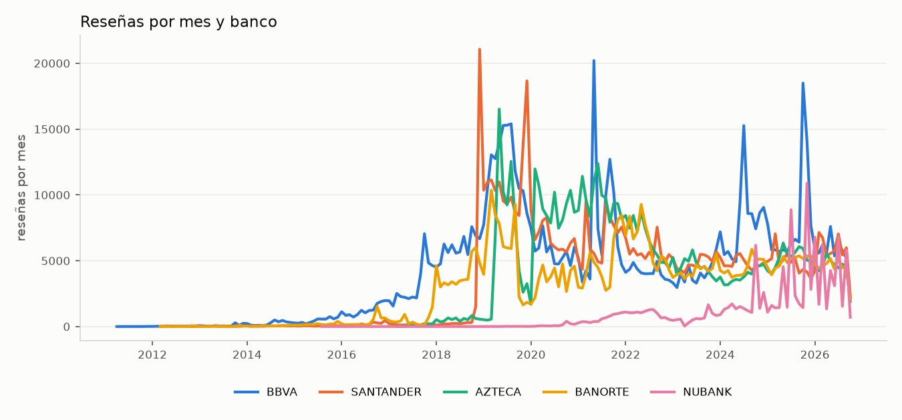
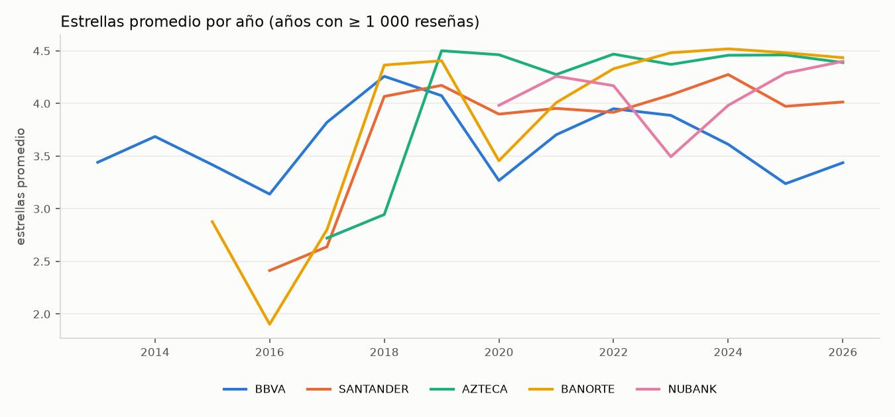
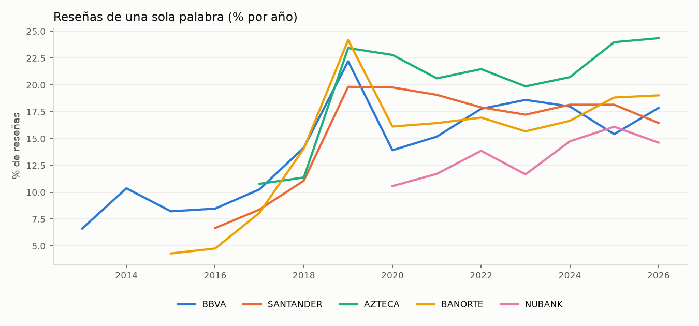
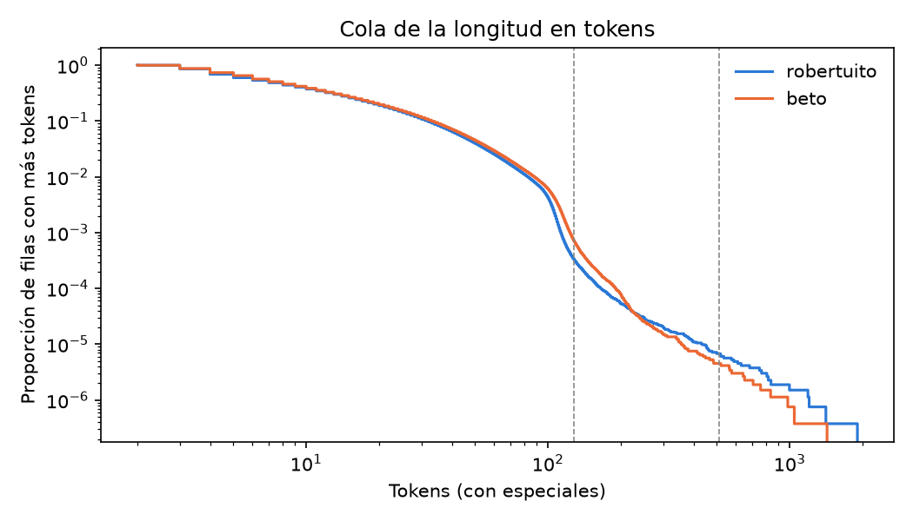

# EDA global del TDS (EPIC-5, feature 5.2) — primera pasada

> **Estado (2026-10-20): vigente.** Los hallazgos H1–H10 y los conteos siguen valiendo para el snapshot `tds_20261016T054714Z`. Índice: [`README.md`](../README.md).
> * **Resuelto después:** el proxy de incongruencia lo midieron el oro y la plata (estrellas distintas del texto en 10–13 %; ver [`gold_v1`](../labeling/gold_v1_report.md), sección 2, y la [plata](../labeling/silver_v0_report.md)); la limpieza por familia la cerró 5.4 (`texto_sanitizado`; [competencia de modelos](../sentiment/sentiment_models_v0_report.md), sección 2).
> * **Cerrado el 2026-10-20 ([sección 5](#5-pendientes-cerrados-tokens-multi-aspecto-y-léxico)):** longitud en tokens, proporción multi-aspecto de las negativas y cobertura del léxico para reseñas de una palabra.
> * **Feature 5.2 cerrada (2026-10-21), incluida la guía de aspectos `v2.1` ([sección 5.2.1](#521-guía-de-aspectos-v2-y-v21-reapertura-para-55)):** la [*Data Card*](../../governance/data_card.md) `v0.2` incorpora la sección 5. 5.2 se reabrió el 2026-10-20 porque 5.5 va a usar a Gemini para codificar aspectos, y se cerró con la taxonomía final `v2.1`. Se reabre otra vez si hay un snapshot nuevo.

* **Snapshot:** `tds_20261016T054714Z` (2 649 047 reseñas, 5 bancos, 2011-04-01 a 2026-10-14). Ver [`experiments/analytics/README.md`](../../../experiments/analytics/README.md).
* **Reproducible:** [`eda_global.py`](../../../experiments/analytics/src/voc_analytics/eda/eda_global.py) genera [`eda/metrics.json`](metrics.json) y las figuras. Solo publica agregados y frases genéricas repetidas al menos 500 veces y de hasta 4 palabras.
* **Alcance de esta pasada:** volumen, duplicados, longitud, contenido, idioma, estrellas, votos, deriva temporal y parámetros de las reglas de elegibilidad (5.1).
* **Pendiente para 5.2:**
  * proxy de incongruencia estrellas–texto y estimación de reseñas multi-aspecto (requieren el piloto de etiquetado de 5.3);
  * longitud en tokens del tokenizador candidato;
  * evaluación de la limpieza por familia de modelos.

## 1. Hallazgos principales

| # | Hallazgo | Evidencia | Implicación |
| :---: | :--- | :--- | :--- |
| H1 | **La longitud predice las estrellas** | 1 palabra: 4.75★; 3: 4.60★; 11–20: 3.37★; 21–40: 2.53★; 41–60: 2.08★; > 60: ~1.9★ | Las quejas son largas y los elogios cortos. Toda exclusión por longitud sesga los agregados hacia lo negativo. |
| H2 | **Pocos textos concentran el corpus** | 1 383 138 textos únicos (52.2 %), 1 316 799 tras normalizar puntuación. Los 100 más frecuentes cubren 822 894 filas (31.1 %) y los 1 000 más frecuentes el 38.6 %. Solo "excelente" son 171 013 filas (6.5 %) | Predecir por texto único ahorra ~48 % del backfill. Un léxico sobre las frases más frecuentes cubriría casi un tercio de las filas sin modelo. |
| H3 | **Frases genéricas compartidas entre bancos** | 44 696 textos aparecen en más de un banco y cubren 1 297 135 filas (49 %) | No sirven para distinguir bancos; refuerzan H2. |
| H4 | **El corpus no tiene respuestas del banco (exclusión intencional)** | `texto_respuesta_sanitizado` y `fecha_respuesta` son nulos en el 100 % de las filas; `titulo` también | EPIC-3 excluye las respuestas desde la ingesta: no son el foco del análisis y a menudo citaban el nombre de usuario (PII). El modelo trabaja solo con el texto del usuario. |
| H5 | **Dos tipos de picos de volumen** | Campañas aparentes de calificación (muchas estrellas, textos cortos): SANTANDER 2018-12 (21 069; 4.39★; mediana 6 palabras), AZTECA 2019-05 (16 522; 4.65★; 3 palabras). Incidentes aparentes (pocas estrellas, textos largos): BBVA 2025-10 (18 493; 2.18★; 60.9 % de 1★; 12 palabras), BBVA 2025-11 (14 039; 60.7 % de 1★), BBVA 2024-07 (15 266; 34 % de 1★) | Material para probar hacia atrás la detección de incidentes (5.5). Las campañas inflan las estrellas y deben aislarse en los agregados. |
| H6 | **Deriva temporal fuerte** | Estrellas promedio de 1.9–3.5 antes de 2018 a 4.2–4.5 desde 2019, salvo BBVA (3.2–3.7 en 2020 y 2024–2026). Reseñas de ≤ 3 palabras con 5★: 30–50 % de cada año desde 2019 (AZTECA ~50 % en 2025–2026) | No hay una tasa de ruido única: muestreo, validación y métricas por banco × periodo. |
| H7 | **Los votos de utilidad son escasos y de cola larga** | Con al menos un voto: 2.2–4.6 % en los bancos tradicionales y 12.1 % en NUBANK. p99 de 1–11 votos; máximo de 2 370 a 6 321 | El ponderador por votos solo distingue a una fracción pequeña; conviene transformarlo (log, rango) y validarlo en 5.6. |
| H8 | **La detección de idioma no es fiable aquí** | lingua (ES/EN/PT, modo rápido) marca 48 176 filas como EN/PT. En una muestra revisada internamente, casi todas eran español informal con faltas ("exelente", "mui bien", "nu es god") | No usar un detector automático como regla de exclusión. El español no estándar es la norma y pesa en la elección del encoder. |
| H9 | **Poca PII residual y pocos códigos técnicos** | 15 filas con tokens de sanitización (coincide con `pii_findings_count`), 13 con códigos `ref:`, 119 487 con emojis | Los tokens y los códigos `ref:` no son señales de volumen para tópicos. |
| H10 | **Versión de la app desconocida en el 8.8 %** | 232 814 filas con `version_app = UNKNOWN` (5–31 % según banco y año) | Las alertas por versión no cubren esas filas; reportar cobertura. |

Distribución de estrellas por banco (% de filas):

| Banco | 1★ | 2★ | 3★ | 4★ | 5★ |
| :--- | ---: | ---: | ---: | ---: | ---: |
| AZTECA | 9.5 | 2.0 | 3.4 | 9.7 | 75.5 |
| BANORTE | 11.5 | 2.6 | 4.6 | 12.0 | 69.3 |
| BBVA | 24.2 | 4.6 | 4.9 | 8.1 | 58.3 |
| NUBANK | 14.4 | 3.0 | 3.6 | 5.8 | 73.2 |
| SANTANDER | 15.9 | 3.6 | 5.2 | 12.0 | 63.3 |

Las tablas de cada figura están en `eda/metrics.json` (`yearly`, `stars_by_bank` y los conteos mensuales que produce el script).

## 2. Parámetros para las reglas de elegibilidad (5.1)

Conteos sobre las 2 649 047 filas, sin aplicar todavía la precedencia. La propuesta versionada está en [`eligibility_rules.md`](eligibility_rules.md).

| Regla | Filas | % | Observación |
| :--- | ---: | ---: | :--- |
| `TNSS_EMPTY` | 8 | 0.0003 | Vacíos tras la limpieza |
| `TNSS_NO_TEXT_CONTENT` | 19 586 | 0.74 | Sin letras ni dígitos tras quitar emojis y tokens; casi todo son emojis sueltos ("👍" son 6 266) |
| `TNSS_TIME_OUTLIER` (NUBANK) | 175 | 0.007 | Anteriores a 2020-01-01. Con corte en 2020-09-01 (primer mes con ≥ 100 reseñas) serían 542 |
| `TNSS_SINGLE_WORD` | 484 829 | 18.3 | Promedio de 4.75★ |
| `TNSS_NOT_SPANISH` | — | — | **Se propone descartarla** (H8) |
| `TOPIC_TOO_SHORT` con máximo de 1 / 2 / 3 / 4 / 5 palabras | 484 837 / 955 728 / 1 182 736 / 1 365 543 / 1 501 901 | 18 / 36 / 45 / 52 / 57 | Antes de aplicar `TOPIC_NOT_NEGATIVE`. El umbral se fija con el piloto de tópicos |

**Sesgo de excluir las reseñas de una palabra** (estrellas promedio, como sustituto del TNSS hasta tener un modelo):

| Banco | Todas | Sin una palabra | Solo una palabra | Cambio |
| :--- | ---: | ---: | ---: | ---: |
| AZTECA | 4.397 | 4.293 | 4.766 | −0.10 |
| BANORTE | 4.250 | 4.139 | 4.773 | −0.11 |
| BBVA | 3.716 | 3.504 | 4.773 | −0.21 |
| NUBANK | 4.205 | 4.093 | 4.861 | −0.11 |
| SANTANDER | 4.032 | 3.895 | 4.651 | −0.14 |

Excluirlas baja entre 0.10 y 0.21 estrellas el promedio de cada banco. Además, el efecto varía por banco, así que también cambia la comparación entre ellos. Esto apoya que 5.8 evalúe la alternativa del léxico determinista (H2: unas pocas formas como "excelente", "bueno" o "pésima" cubren gran parte de ese 18.3 %).

## 3. Frases genéricas más frecuentes

Solo frases repetidas al menos 500 veces y de hasta 4 palabras (sin riesgo de identificación). Ejemplos:

| Texto | Filas |
| :--- | ---: |
| excelente | 171 013 |
| muy bien | 28 382 |
| muy buena app | 21 266 |
| bueno | 10 607 |
| 👍 | 6 266 |
| fácil de usar | 3 891 |
| buenas | 2 479 |
| la mejor | 2 235 |
| pésima | 1 324 |
| ecxelente | 1 264 |

Las variantes ortográficas ("ecxelente", "exelente") confirman que la normalización y el encoder deben tolerar español informal.

## 4. Siguientes pasos de 5.2

1. ~~Fecha de corte de NUBANK~~: fijada en 2020-01-01 como decisión metodológica, con sensibilidad a 2020-09-01 (`eligibility_rules_v0.1`).
2. ~~Origen de la falta de respuestas (H4)~~: exclusión intencional en EPIC-3.
3. ~~Medir la longitud en tokens con los tokenizadores candidatos de 5.4~~: [sección 5.1](#51-longitud-en-tokens).
4. Con la plata y el oro de 5.3:
   * ~~proxy de incongruencia por banco × periodo~~: lo midieron el oro y la plata;
   * ~~proporción multi-aspecto~~: [sección 5.2](#52-proporción-multi-aspecto-de-las-negativas), validada por el autor (κ 0.42 con la guía `v1`; Gemini es cota inferior);
   * ~~cobertura del léxico determinista para reseñas cortas~~: [sección 5.3](#53-léxico-determinista-para-reseñas-de-una-palabra).
5. ~~Completar la *Data Card*~~: versión `0.2` (2026-10-20), con la sección 5.

## 5. Pendientes cerrados: tokens, multi-aspecto y léxico

Segunda pasada (2026-10-20), con el mismo snapshot. Cada análisis es un módulo de `voc_analytics.eda` y solo publica agregados.

### 5.1 Longitud en tokens

[`eda_tokens.py`](../../../experiments/analytics/src/voc_analytics/eda/eda_tokens.py) → [`eda/tokens_metrics.json`](tokens_metrics.json). Mide `texto_sanitizado` con el preprocesamiento de los modelos (`preprocess_tweet`) y sin truncar, en los 1 427 640 textos únicos de ese campo, ponderando por filas. Corre en ~3 min de CPU.

| Tokenizador | p50 | p95 | p99 | p99.9 | Máx. | Filas > 128 | Filas > 512 | Tokens por palabra |
| :--- | ---: | ---: | ---: | ---: | ---: | ---: | ---: | ---: |
| RoBERTuito | 7 | 45 | 83 | 113 | 1 907 | 0.033 % (868) | 0.001 % | 1.40 |
| BETO | 8 | 48 | 88 | 124 | 1 428 | 0.071 % (1 874) | < 0.001 % | 1.47 |

* **El tope de entrenamiento de 128 tokens** (`MAX_LENGTH` de 5.4) trunca 868 filas con RoBERTuito y 1 874 con BETO, menos del 0.1 %. No hace falta subirlo, y 512 cubre todo salvo unas decenas de filas.
* **Por banco × periodo** (`sampling.strata`), el p99 va de 64 a 126 tokens con RoBERTuito y de 67 a 146 con BETO. El estrato con más truncado es NUBANK `<=2019` (0.6 % y 1.1 %), que de todos modos queda fuera por `TNSS_TIME_OUTLIER`.
* **Por texto único** la cola es más larga (p99 97 con RoBERTuito) porque los textos cortos se repiten. El costo de inferencia por texto único casi no cambia con el tope.

### 5.2 Proporción multi-aspecto de las negativas

[`eda_aspects.py`](../../../experiments/analytics/src/voc_analytics/eda/eda_aspects.py) → [`eda/aspects_v0_metrics.json`](aspects_v0_metrics.json) y [`eda/aspects_v1_metrics.json`](aspects_v1_metrics.json); guía: [`eda_aspects_guideline_v1.md`](archive/eda_aspects_guideline_v1.md). Informa la elección entre ABSA y tópicos de 5.5.

> **Reabierta y cerrada con la guía `v2.1` (2026-10-21).** Las cifras de esta sección son de `v1`. La guía de aspectos se rehízo para 5.5: los resultados y la taxonomía final están en la [sección 5.2.1](#521-guía-de-aspectos-v2-y-v21-reapertura-para-55). El multi-aspecto de `v1` estaba inflado por su regla 3 (32.1 %); con `v2.1` es 24.7 %.

* **Muestra:** 1 500 extracciones con reemplazo de las filas `NEG` de la plata (`prompt_v3`), con probabilidad proporcional a 1 / π. Representan ~706 000 filas negativas elegibles y sus proporciones estiman las de la población sin pesos. Son 1 434 textos únicos.
* **Codificación:** Gemini (`gemini-3.6-flash`, Vertex AI dentro de GCP) con 10 familias de problema (acceso, falla general, lentitud, transferencias y pagos, dinero y cargos, productos, atención, diseño y actualizaciones, compatibilidad, otro), según la [guía de aspectos `v1`](archive/eda_aspects_guideline_v1.md). Un mismo problema cuenta una vez, con su familia más específica, y se marca aparte si la queja trae un elogio concreto. Dos rondas, $0.17 en total:
  * `aspects_v0` (prompt sin guía escrita);
  * **`aspects_v1` (vigente):** sigue la guía `v1`, que hace explícito "sin problema concreto" y suma `DS` cuando el texto culpa a una actualización. Las cifras de abajo son de `v1`; `v0` dio la misma proporción poblacional (32.1 %).
* **Validación del autor:** 100 de esos textos, codificados a ciegas con [`aspects_app.py`](../../../experiments/analytics/src/voc_analytics/eda/aspects_app.py) (ver abajo).

| Medida (filas `NEG` elegibles) | Proporción | IC 95 % |
| :--- | ---: | :--- |
| **Multi-aspecto (2 o más familias)** | **32.1 %** | 29.7–34.3 |
| Un aspecto | 60.7 % | 58.3–63.1 |
| Sin problema concreto ("pésima", "no sirve") | 7.3 % | 6.0–8.6 |
| Queja con un elogio concreto | 10.8 % | 9.3–12.5 |

| Corte | Multi-aspecto |
| :--- | :--- |
| Por largo (palabras) | 1: 0 % · 2–5: 2 % · 6–15: 21 % · 16–40: 41 % · más de 40: 67 % |
| Negativas con al menos k palabras | k = 3: 34 % · k = 5: 36 % · k = 10: 43 % · k = 20: 51 % (el 43 % de las filas `NEG`) |
| Por estrellas | 1★ 35 % · 2★ 36 % · 3★ 33 % · 4★ 18 % · 5★ 14 % |
| Por banco | De 27 % (BANORTE) a 34 % (SANTANDER); los IC se traslapan |

* **Familias más frecuentes:** acceso 35 %, falla general 26 %, diseño y actualizaciones 18 %, transferencias y pagos 15 %, lentitud 11 % y atención 9 %. Los pares más comunes en las multi-aspecto son acceso + falla, acceso + diseño y acceso + atención.
* **Validación del autor (100 textos a ciegas): acuerdo moderado, y Gemini cuenta de menos.**
  * **Cifras:** en los mismos 100 textos, el autor marca multi-aspecto el 44 % [35, 54] y Gemini (`v1`) el 32 % [24, 42] (Wilson). En la decisión multi o no, κ 0.42 [0.24, 0.59] (bootstrap) y 72 % de acuerdo.
  * **Primera pasada:** con `v0` el κ fue 0.29. El autor no sabía que existía "sin problema concreto" y codificó esos casos como falla general; revisó con la guía `v1` los 39 textos que había marcado así.
  * **El desacuerdo que queda es de definición, sobre todo en diseño:** en 28 textos el conjunto de Gemini está contenido en el del autor, contra 9 al revés. De los códigos que solo pone el autor, 25 son `DS`. El autor lo aplica más ampliamente que Gemini, aun con la regla 3.
  * **Por código** el acuerdo es bueno en lentitud (κ 0.81), acceso (0.70), transferencias (0.67) y productos (0.65), y bajo en diseño (0.39), dinero y cargos (0.26) y compatibilidad (≈ 0, casi sin casos).
  * **Lectura:** el 32 % de Gemini es una **cota inferior**. Con el criterio del autor la proporción ronda el 44 %, con un IC amplio por n = 100. La conclusión para 5.5 no cambia: un tercio o más de las negativas mezcla problemas. Para usar a Gemini como codificador de aspectos a escala, falta afinar la definición de `DS` (guía `v2`).
* **La cota por palabras clave** (expresiones regulares, sin modelo) da 38 % sobre toda la plata `NEG`, pero coincide poco con Gemini (κ 0.42 en la decisión multi o no). No sirve como medición, solo como cota.
* **Implicación para 5.5:** un tercio de las quejas mezcla problemas, y la mitad de las de 20 palabras o más. Un modelo de un tópico por reseña asignaría mal esas reseñas, así que conviene un esquema que permita varios aspectos (ABSA o tópicos por oración o cláusula). Las negativas de 1 a 5 palabras casi nunca son multi-aspecto. **Corregido (2026-10-21):** antes decía que casi nunca tienen un problema concreto, y no se sostiene. Según 5.5, nombran un problema concreto el 4 % [1, 18] de las negativas de una palabra, el 46 % [33, 60] de las de 2 y el 77 % [70, 83] de las de 3 a 5; lo que casi nunca son es multi-aspecto (0–4 %) ([`topics_report.md`](../topics/topics_report.md#43-topic_too_short-k--1-se-confirma-con-v21-y-los-5-bancos), sección 4.3; confirmadas con `aspects_v2_1` y los 5 bancos). Para `TOPIC_TOO_SHORT`, 5.5 recomienda k = 1, pendiente de la decisión del autor.

#### 5.2.1 Guía de aspectos `v2` y `v2.1` (reapertura para 5.5)

[`eda_aspects_v2.py`](../../../experiments/analytics/src/voc_analytics/eda/eda_aspects_v2.py) → [`eda/aspects_v2_metrics.json`](aspects_v2_metrics.json) (regla de decisión, tal como se fijó) y [`eda/aspects_v2_1_metrics.json`](aspects_v2_1_metrics.json) (taxonomía final). Guía: [`eda_aspects_guideline.md`](eda_aspects_guideline.md) (`v2.1`). La `v2` está congelada en [`eda_aspects_guideline_v2.md`](archive/eda_aspects_guideline_v2.md).

* **Por qué se reabrió:** 5.5 va a usar a Gemini para codificar aspectos, y `DS` (diseño y actualizaciones) tenía κ 0.39 con `v1`. Además, la regla 3 de `v1` sumaba `DS` a todo problema atribuido a una actualización, lo que inflaba el multi-aspecto.
* **Taxonomía final (`v2.1`), 11 familias y dos marcas:**
  * **familias:** `AC` acceso y autenticación (incluye todo el token), `TR`, `DI`, `PR`, `AT`, `FA`, `LE`, `CO` compatibilidad, instalación y actualización, `DV` diseño visual, `UX` usabilidad, recorrido y funciones quitadas, y `OT` "sin familia" (el último recurso, cuya prevalencia es la alarma de un tema nuevo);
  * **marcas ortogonales:** `u` (problema atribuido a una actualización) y `s` (seguridad o privacidad). No son familias y no cuentan para el multi-aspecto.
* **Proceso:**
  * tres rondas de calibración autor–Gemini, de 30, 20 y 30 textos, con acuerdo exacto de 33 %, 40 % y 47 %;
  * muestra de 300 textos (150 enriquecidos con diseño y 150 aleatorios), codificada a ciegas por el autor con `v2` y luego otra vez, 17 horas o más después y en otro orden, con `v2.1`;
  * Gemini (`gemini-3.6-flash`, Vertex AI dentro de GCP) sobre la muestra y las 1 500 extracciones representativas. Costo total: $0.34.
* **Regla de decisión** (fijada antes de codificar; guía, sección 6), con `v2`:
  * `DV`: κ intra-autor 0.97, κ autor–Gemini 0.81, confusión con `UX` 17 %, prevalencia 2.1 %. Cumple.
  * `UX`: κ autor–Gemini 0.55. No cumple, y la regla fusionaría `DV` y `UX`.
  * `FQ` (funciones quitadas): prevalencia 0.8 % y κ 0.59. No cumple, y se fusiona con `UX`.
* **Decisiones del autor, documentadas como desviaciones:**
  * el κ bajo de `UX` venía de su frontera con `CO` (instalación y actualización), `AC` y `PR` (token y fricción), no de `DV` (confusión del 3 %). En lugar de fusionar, `v2.1` movió la instalación y la actualización a `CO` y el token a `AC`, y agrupó las casillas de la app en orden de decisión;
  * criterio fijado antes de recodificar: primero se mide el efecto aislado sobre `UX`, y después se decide si `DV` se une, por definición y prevalencia;
  * la recodificación intra-autor fue de toda la muestra con `v2.1` a las 12 horas o más, no de 50 textos con la misma guía a la semana, por el plazo del proyecto. Por eso solo mide la estabilidad en los códigos que no cambiaron de definición, y es optimista.

| Código | κ autor–Gemini con `v2` | κ con `v2.1` | Prevalencia en las negativas (`v2.1`, Gemini) |
| :--- | ---: | ---: | :--- |
| `AC` acceso y autenticación | 0.70 | 0.70 | 24.4 % [22.3, 26.6] |
| `FA` falla general | 0.62 | 0.55 | 29.5 % [27.3, 31.9] |
| `TR` transferencias y pagos | 0.74 | 0.68 | 13.7 % [12.1, 15.5] |
| `PR` productos y cuentas | 0.52 | 0.62 | 11.5 % [9.9, 13.1] |
| `LE` lentitud general | 0.92 | 0.86 | 10.6 % [9.1, 12.1] |
| `UX` usabilidad, recorrido y funciones quitadas | 0.55 | **0.74** | 8.3 % [6.9, 9.7] |
| `AT` atención | 0.66 | 0.68 | 8.1 % [6.7, 9.5] |
| `CO` compatibilidad, instalación y actualización | 0.61 | 0.77 | 7.9 % [6.6, 9.3] |
| `DI` dinero y cargos | 0.71 | 0.62 | 2.7 % [1.9, 3.5] |
| `DV` diseño visual | 0.81 | 0.74 | 1.8 % [1.2, 2.5] |
| `OT` sin familia | 0.33 | 0 | 0.6 % [0.3, 1.1] |
| Marca `u` (actualización) | 0.66 | 0.70 | 16.3 % [14.4, 18.2] |
| Marca `s` (seguridad) | 0.71 | 0.56 | 2.1 % [1.4, 2.8] |

* **Resultado:**
  * con `v2.1`, `UX` pasa de κ 0.55 a 0.74 sin fusionarse con `DV`. La confusión `DV`↔`UX` es del 12.5 %;
  * el acuerdo exacto autor–Gemini es del 58 % (54 % con `v2`);
  * estabilidad intra-autor en los códigos sin cambio de definición: `DV` 0.97, `LE` 0.88, `DI` 0.85, `AT` 0.71, `u` 0.83, `s` 0.93.
* **`DV` queda separado** (decisión del autor, 2026-10-21) como excepción a la prevalencia mínima del 2 %: se distingue de `UX`, y el 1.8 % de ~706 000 negativas son unas 13 000 reseñas, suficientes para seguirlo en el tiempo.
* **Multi-aspecto recalculado:** 24.7 % [22.6, 26.8] de las negativas (32.1 % con `v1`), y 43 % de las de 20 palabras o más. Por largo: 0 % con una palabra, 2 % con 2 a 5, 13 % con 6 a 15, 31 % con 16 a 40 y 58 % con más de 40. En la muestra, el autor marca menos que Gemini (23 % contra 30 %): se invirtió el sesgo de `v1`.
* **Límites:**
  * la marca `s` tiene solo 6 a 8 positivos entre 300; su κ (0.56 con `v2.1`, 0.71 con `v2`, 0.61–0.78 en la calibración) no es concluyente;
  * `FA` bajó a 0.55 y `OT` casi no tiene casos;
  * el κ intra-autor es optimista por la cercanía entre codificaciones.
* **Para 5.5:**
  * las etiquetas `aspects_v2_1` de Gemini sobre las 1 500 extracciones tienen las columnas `text_id`, `codes`, `actualizacion`, `seguridad` y `elogio`; ver `esquema_salida` en las métricas;
  * `u` se puede usar como señal;
  * `s` solo con cautela.

### 5.3 Léxico determinista para reseñas de una palabra

[`eda_lexicon.py`](../../../experiments/analytics/src/voc_analytics/eda/eda_lexicon.py) → [`eda/lexicon_metrics.json`](lexicon_metrics.json). Insumo para la decisión de `TNSS_SINGLE_WORD` en 5.8.

* **Forma:** `texto_limpio` en minúsculas, sin acentos ni signos y sin letras repetidas seguidas ("Excelenteee!!" → "excelente").
* **Léxico:** formas de una palabra de la plata, sin reseñas del oro, con al menos 3 filas y una pureza ponderada de al menos 0.9. La etiqueta es la mayoritaria de Gemini. Resultan **151 formas**: 117 `POS`, 22 `NEG`, 7 `NEU` y 5 no evaluables.

| Medida | Valor |
| :--- | :--- |
| Filas elegibles de una palabra | 465 633 (6 604 formas distintas) |
| **Cobertura del léxico** | **95.3 %** de esas filas; de 94.7 % (BBVA) a 95.7 % (SANTANDER) por banco, y al menos 93.1 % en todo estrato banco × periodo |
| Techo con las K formas más frecuentes | 10: 82.8 % · 50: 92.0 % · 100: 94.7 % · 500: 97.8 % |
| **Exactitud contra el oro *dev* aleatorio** | **99.1 %** (105 de 106 cubiertos; ponderada 98.2 %); cubre 94 % de los 113 ítems de una palabra |
| Sesgo en estrellas por banco al excluir todas las de una palabra | de −0.10 a −0.21 (igual que la sección 2) |
| Sesgo al excluir solo las que el léxico no cubre | de −0.001 a −0.007 |

* **Implicación para 5.8:** el léxico conserva el 95 % de las reseñas de una palabra y con eso elimina casi todo el sesgo en las estrellas que causa excluirlas, con una exactitud igual o mayor a la de M4 en ese tramo (~96 %). Las 21 735 filas no cubiertas (4.7 %) pueden excluirse con un sesgo despreciable o pasar al modelo.
* **Límites:** las etiquetas del léxico vienen de Gemini, no de personas, y el oro de una palabra tiene solo 113 ítems. El léxico se fija con la plata; formas nuevas posteriores al snapshot quedan sin cubrir hasta que se regenere.
