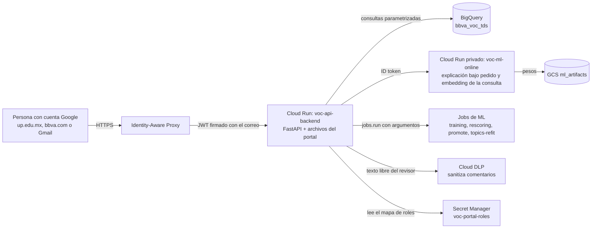

# Stack y arquitectura del portal

> **Estado (2026-10-25): versión 0.1.** Fija cómo se construye y se despliega el portal (`web/portal/`) y su API (`services/api-backend/`). El autor delegó estas elecciones (2026-10-25); cada una lleva su criterio para poder revisarla. La apariencia está en la [guía visual](visual_guide.md).

## 1. Despliegue



* **Un solo servicio sirve la API y el portal.** La imagen de `voc-api-backend` construye el portal con Node en una etapa y lo copia como archivos estáticos que FastAPI sirve en `/`; la API vive en `/api/v1`. Mismo origen: sin CORS, una sola protección con IAP y un solo despliegue. Los archivos con *hash* se sirven con caché inmutable y `index.html` sin caché; cualquier ruta que no sea `/api/*` ni un archivo devuelve `index.html`, para que funcione la navegación del lado del cliente.
* **IAP delante de Cloud Run**, sin cuentas propias. IAP deja pasar solo a las cuentas autorizadas y agrega el encabezado `x-goog-iap-jwt-assertion`; la API verifica la firma y la audiencia y toma el correo de ahí. Ningún otro encabezado de identidad se acepta.
* **Roles fuera de git:** IAP solo autentica; los roles (lector, analista, revisor, administrador) salen de un mapa `correo → roles` guardado cifrado en la configuración de Pulumi. Pulumi da a cada correo el permiso de IAP y publica el mapa en Secret Manager (`voc-portal-roles`), que la API lee con una caché de 5 minutos. Agregar a una persona es un `pulumi config set --secret` y un `pulumi up`.
* **Lo que necesita PyTorch va aparte.** La explicación bajo pedido (RoBERTuito) y el embedding de una consulta de búsqueda (MiniLM, ~470 MB) no caben en la API de 1 GiB. Corren en `voc-ml-online`, un servicio privado con la imagen de `ml-inference` (comando `serve`), 2 vCPU y 4 GiB, con mínimo 0 instancias. El primer uso tras un rato sin tráfico tarda en cargar el modelo (decenas de segundos) y la pantalla lo avisa.
* **La API lanza Jobs, no los corre.** Reentrenar, promover, hacer *rollback* y re-ajustar tópicos son `jobs.run` de Cloud Run con argumentos (`--actor-hash`, `--reason`), con permiso solo sobre esos Jobs.

## 2. Backend

| Pieza | Elección | Criterio |
| :--- | :--- | :--- |
| Lenguaje | Python 3.11, miembro del workspace uv de la raíz | Como el resto del monorepo |
| Framework | FastAPI con Pydantic v2 | Ya está en `uv.lock`; genera el esquema OpenAPI del que salen los tipos del portal |
| Contratos | Los modelos de `voc-common` para lo que se lee o escribe en BigQuery; modelos de respuesta propios de la API en `api_backend/schemas/` | Nunca `dict[str, Any]` entre capas |
| BigQuery | `google-cloud-bigquery` con consultas parametrizadas, `maximum_bytes_billed` por consulta y caché en memoria con tiempo de vida para los agregados | Costo acotado y sin inyección de SQL |
| Escrituras | `INSERT` DML con la lista de columnas explícita y entre comillas invertidas (`at` es palabra reservada), idempotente por clave (`INSERT … SELECT … WHERE NOT EXISTS`) | Solo inserción, sin *streaming*; lo que se aprendió al cargar el histórico en dev |
| Identidad | `google-auth` para verificar el JWT de IAP | Biblioteca oficial |
| Hash del actor | `sha256("<sal>:<correo en minúsculas>")`, con la sal `USER_HASH_SALT`, la misma regla de `hash_username_pii` | Un mismo correo da el mismo hash en la API y en la línea de comandos |
| Texto libre | Comentarios y notas pasan por Cloud DLP (las plantillas de la sanitización) antes de guardarse; si DLP falla, no se guarda el comentario | El regex local no detecta nombres de personas |
| Pruebas | `pytest` con `TestClient` y un doble de BigQuery en memoria; sin red | Como el resto del monorepo |
| Configuración | `pydantic-settings`; nada de proyectos ni llaves en el código | Regla del backlog |

## 3. Frontal

| Pieza | Elección | Criterio |
| :--- | :--- | :--- |
| Runtime de construcción | Node 24 LTS (`.nvmrc`, `engines` y la imagen `node:24-bookworm-slim`) y npm. La máquina del autor tiene Node 26.12, que todavía no es LTS y construye igual | npm viene con Node; un gestor más no aporta a un proyecto de este tamaño. La versión LTS es la que tiene soporte largo en CI y en la imagen |
| Empaquetador | **Vite** | El sucesor natural de webpack: arranque instantáneo en desarrollo, construcción con Rollup, configuración mínima |
| Lenguaje | **TypeScript** en modo estricto | Los errores de tipos salen al construir (`npm run build` corre `tsc -b` antes de `vite build`) |
| Interfaz | **React 19** | Frente a Vue y Angular: el ecosistema más grande para gráficas, tablas y componentes accesibles, y el que mejor dominan los modelos que van a escribir el código. Angular es más pesado de aprender; Vue sería válido, con menos bibliotecas para este caso |
| Rutas | **React Router 7** (modo de datos, como SPA, sin servidor) | El estándar; los filtros globales viven en los parámetros de la URL |
| Datos del servidor | **TanStack Query 5** | Caché, reintentos, estados de carga y error; evita un *store* global |
| Cliente de la API | **openapi-typescript** + **openapi-fetch** | Los tipos salen del OpenAPI de FastAPI (`npm run api:types`); si la API cambia, el portal no compila hasta ajustarse |
| Estilos | **Tailwind CSS 4** con los *tokens* de la guía en `@theme` | Utilidades en el marcado; los colores y tamaños son variables CSS con los nombres de la guía, así que no se inventan valores |
| Componentes | **shadcn/ui** (copiados al repo, sobre Radix UI) | Accesibles (teclado, foco, ARIA) y editables; no es una dependencia que imponga su estética |
| Íconos | **lucide-react** | Trazo sobrio y consistente |
| Tablas | **TanStack Table 8** + **TanStack Virtual** | Sin estilos propios; paginación y orden del servidor, filas virtualizadas |
| Formularios | **React Hook Form** + **Zod** | Validación declarativa; los motivos obligatorios y los rangos de las políticas |
| Gráficas | **D3 7** (módulos: `d3-scale`, `d3-shape`, `d3-array`, `d3-time-format`, `d3-brush`) | Decisión del autor. D3 calcula escalas y formas y React dibuja el SVG; D3 no toca el DOM salvo en el *brush* |
| Series de tiempo largas | **dygraphs 2** | Decisión del autor. Diez años de días por banco en *canvas*, con zoom, selector de rango y anotaciones de cambio de versión |
| Fórmulas | **MathJax** (con `rehype-mathjax`, se dibuja a SVG al construir) | Decisión del autor. Sin JavaScript de MathJax en el navegador ni parpadeo al cargar |
| Diagramas | **Mermaid 11**, cargado solo en las páginas que lo usan | Decisión del autor. Pesa más de 1 MB; se importa de forma perezosa |
| Texto de la tesis y de la ayuda | **MDX** (`@mdx-js/rollup`) con `remark-gfm`, `remark-math` y `rehype-slug` | Markdown que puede incluir componentes (`<Figure id="…" />`). No hace falta exportar a PDF (decisión del autor, 2026-10-25) |
| Fechas | `date-fns` + `Intl` | Formatos de `es-MX` |
| Tipografías | `@fontsource-variable/source-serif-4`, `@fontsource-variable/source-sans-3`, `@fontsource/source-code-pro` | Servidas por el portal; IAP no deja pasar a un CDN sin sesión y así no salen datos de navegación |
| Lint y formato | **Biome** | Una sola herramienta rápida, como `ruff` en Python |
| Pruebas | **Vitest** + **Testing Library** + **MSW** (dobles de la API) + **vitest-axe** | Corren sin red ni navegador real; `axe` revisa la accesibilidad |
| Prueba de punta a punta | Playwright, deseable | Un recorrido por sección contra la API con dobles |

**Versiones:** al crear el proyecto se instala la estable más reciente de cada paquete y `package-lock.json` las fija; se commitea el lock. No se suben versiones mayores a mitad de la épica sin motivo.

### 3.1 Estructura de `web/portal/`

```
web/portal/
├── index.html                # Vite lo espera en la raíz (hoy hay uno vacío en public/: se borra)
├── package.json, package-lock.json, tsconfig*.json, vite.config.ts, biome.json, .nvmrc
├── public/                   # favicon y logos oficiales en SVG
└── src/
    ├── main.tsx, router.tsx  # arranque y tabla de rutas (una por sección, cargada de forma perezosa)
    ├── api/                  # schema.d.ts (generado), client.ts, un archivo de hooks por sección
    ├── auth/                 # useMe(), <RequireRole>, menú de usuario
    ├── filters/              # useGlobalFilters(): bancos y periodo en la URL
    ├── config/               # banks.ts (seudónimo y color), nav.ts, glossary.ts
    ├── styles/               # tokens.css (la guía visual), index.css
    ├── lib/                  # format.ts (números, fechas, intervalos)
    ├── components/           # componentes base de la guía (KpiCard, ChartFrame…)
    │   └── ui/               # componentes de shadcn/ui
    ├── charts/               # primitivas de D3 (useChartSize, ejes, líneas, bandas) y <TimeSeries> sobre dygraphs
    ├── sections/             # una carpeta por sección: landing, report, cockpit, explorer, hitl, alerts, mlops, admin, governance
    └── test/                 # configuración de Vitest y manejadores de MSW
```

### 3.2 Reglas de código del frontal

* **Una fuente de verdad por cosa:** colores y tamaños en `tokens.css`; bancos en `banks.ts`; textos de ayuda en `glossary.ts`; tipos de la API en `schema.d.ts`. Ningún hex, nombre de banco ni tipo de respuesta escrito a mano en un componente.
* **Los filtros viven en la URL** (`?bancos=BBVA,NUBANK&desde=2026-07-01&hasta=2026-10-24`) y se leen con `useGlobalFilters()`. Una gráfica que filtra (clic en una barra, *brush* en una serie) escribe en la URL; las demás reaccionan. Es el *crossfilter* del portal, sin una biblioteca aparte.
* **Ningún texto de reseña en el almacenamiento del navegador** (`localStorage`, `sessionStorage`, IndexedDB) ni en la URL.
* **Cada sección se carga de forma perezosa**, así que el lector no descarga el código del HITL ni de la administración.
* **El rol decide qué se ve, la API decide qué se entrega:** ocultar un menú no es seguridad; la API rechaza con 403 lo que el rol no permite.

### 3.3 Comandos

| Comando | Qué hace |
| :--- | :--- |
| `npm ci` | Instala exactamente lo del lock |
| `npm run dev` | Vite en `localhost:5173`, con `/api` redirigido a `localhost:8080` |
| `npm run build` | `tsc -b && vite build` a `dist/` |
| `npm run check` | `biome check .` |
| `npm test` | Vitest una vez (en CI) |
| `npm run api:types` | Regenera `src/api/schema.d.ts` desde `services/api-backend/openapi.json` |

## 4. Desarrollo local

1. API: `uv run --package api-backend uvicorn api_backend.main:app --reload --port 8080` desde la raíz, con `PORTAL_AUTH_MODE=local` y `PORTAL_LOCAL_USER=<correo>` y `PORTAL_LOCAL_ROLES=lector,analista,revisor,administrador`. Ese modo solo existe con `ENVIRONMENT=local`: la configuración falla al arrancar si se pide en otro ambiente.
2. Portal: `npm run dev` en `web/portal/`.
3. Sin GCP, la API arranca con `PORTAL_DATA=fixtures`, que lee datos sintéticos de `services/api-backend/tests/fixtures/`, para trabajar en el diseño sin costo ni credenciales.

## 5. CI y CD

* **CI** (`.github/workflows/ci.yaml`): se suman el `pytest` de `api_backend` con cobertura ≥ 85 %, un trabajo de Node (`npm ci`, `npm run check`, `npm test`, `npm run build`) y la imagen de `api-backend` con su prueba de humo (usuario sin root, `/healthz` responde y sirve `index.html`).
* **CD** (`cd-cloud-build.yaml`): agrega `web/**` y `docs/thesis/**` a las rutas que disparan la construcción de `api-backend`.
* **Imagen:** `services/api-backend/Dockerfile` multi-stage: `node` construye el portal → `uv` instala `api-backend` y `voc-common` → `python:3.11-slim` sin root con `dist/` en `/app/static`. El `.dockerignore` (lista de permitidos) suma `services/api-backend`, `web/portal` (sin `node_modules` ni `dist`), `docs/thesis` y los JSON de métricas de `docs/analytics` que usa el reporte.
